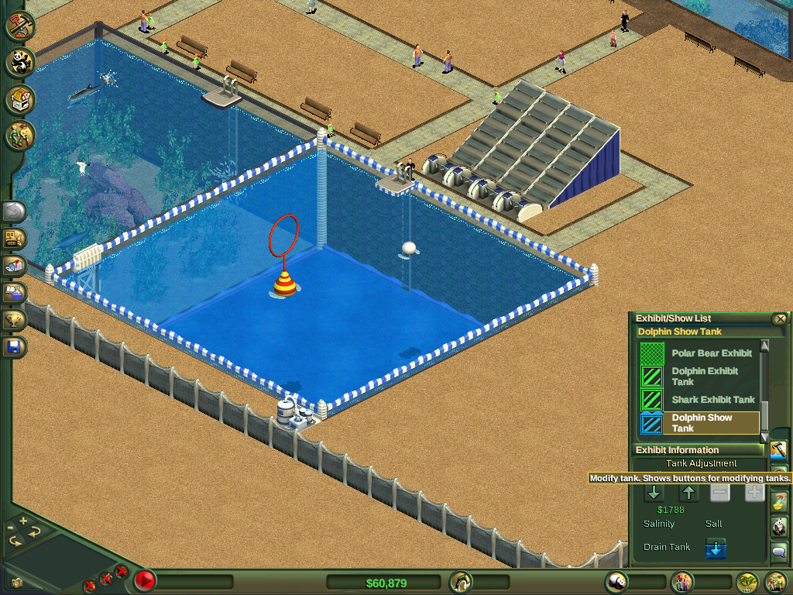
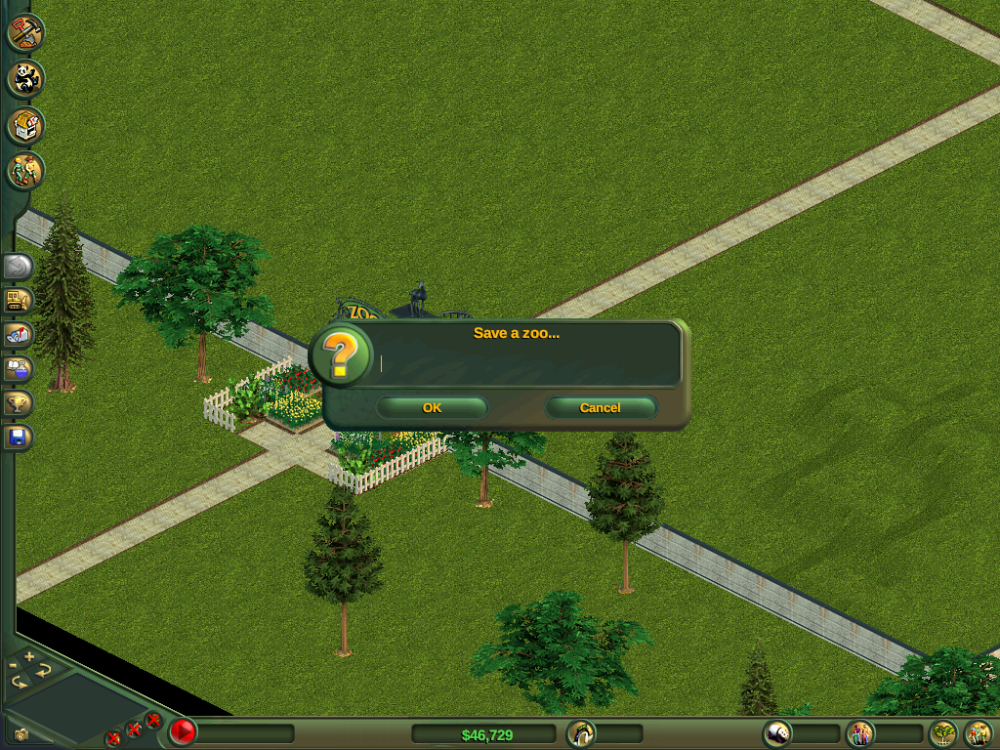
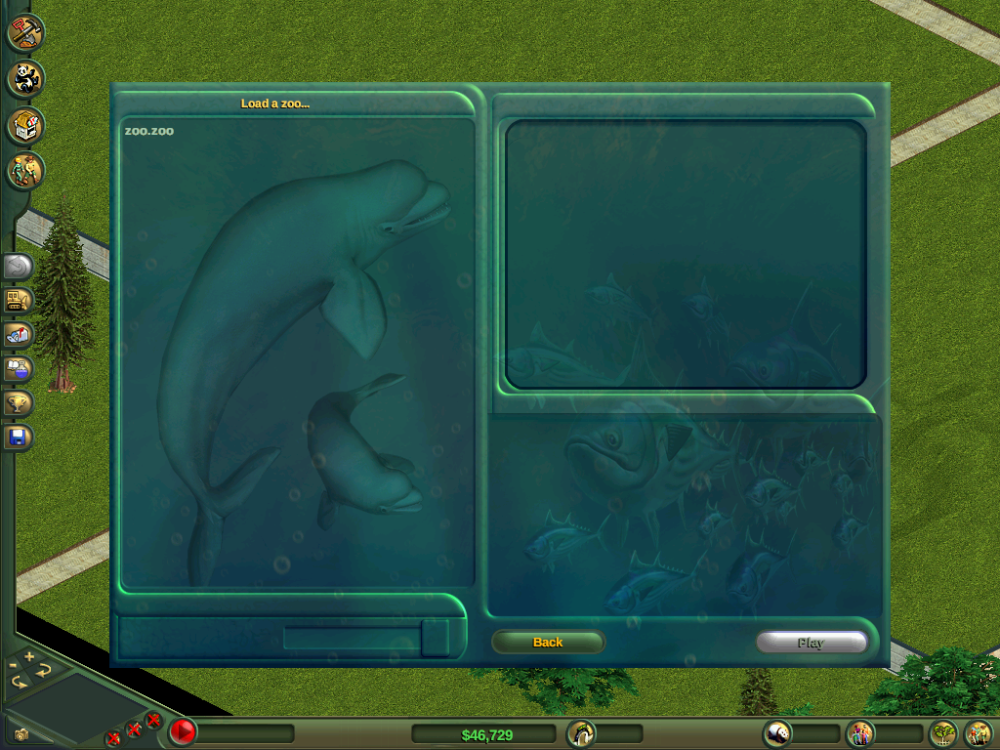

# RustyZoo screenshots

Pictures made by RustyZoo, the open reimplementation of Zoo Tycoon, as it develops, with pictures of the
original game next to them in `original/` for comparison. One folder per milestone (`m2/`, `m3/`, ...),
each with a README that says which command made each picture.

RustyZoo is not affiliated with Microsoft. The pictures show Zoo Tycoon graphics (c) Microsoft, drawn by
RustyZoo from the game's own data or, in `original/`, by the original game.

## Latest

<!-- latest -->

<!-- /latest -->
